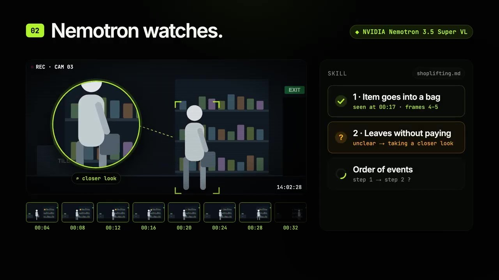

<h1 align="center">Lookout</h1>

<p align="center">A visual harness that lets Nemotron watch for rules written in Markdown.</p>

<p align="center">
  <a href="https://youtu.be/pSXCe_UnDtE">
    
  </a>
</p>

A business rule usually involves more than recognizing an object: an item must go into a bag before it is moved away, or a machine must stay still while its guard is open. The people doing the work know the procedure. Turning it into something a camera can check is the difficult part.

Lookout puts that procedure in an editable Markdown file, called a **skill**. It runs the skill on a recording or live camera and links each assessment to timestamped frames.

## How it works

1. **Write the skill.** Describe observable steps and alert conditions, or demonstrate a task on camera and let Nemotron draft a procedure for you to review.
2. **Watch the sequence.** NVIDIA Nemotron 3.5 Super VL reads sampled frames, assesses the steps and their order, and can request a denser look at an unclear moment.
3. **Review the evidence.** The harness validates frame references and timing. Alert candidates receive a second model check before appearing with their evidence for human review. Unsupported steps stay uncertain.

This makes packing checks, safety procedures and loss-prevention review configurable by the people who know the task. Editing a rule does not require training a new model, and every result has an evidence trail to inspect. A visual alert remains a review candidate, not proof of intent or wrongdoing.

Built at Junction 2026 around **NVIDIA Nemotron**, using **Next.js, TypeScript, Bun and Vercel AI Gateway**. Selected frames are sent for inference; saved alert evidence stays in the browser. Source-assisted skill drafting is an optional extension documented in the [development guide](docs/DEVELOPMENT.md#source-grounded-skill-research).

## Run locally

```sh
bun install
# Set AI_GATEWAY_API_KEY in apps/web/.env.local
bun run dev
```

Open [localhost:3020](http://localhost:3020). Sample recordings are included. See the [development guide](docs/DEVELOPMENT.md) for rule syntax, evaluations and deployment.
